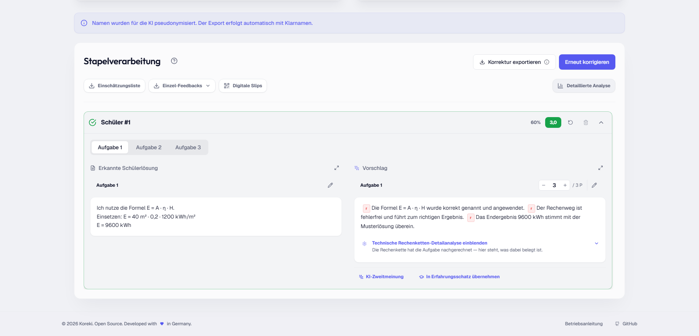

# Koreki

**Dein KI-Korrektur Assistent.** Koreki liest die Arbeiten deiner Klasse, schlägt für jede Aufgabe Punkte und ein Feedback vor — und du entscheidest. Läuft auf deinem Rechner oder dem Server deiner Schule, auf Wunsch mit einer lokalen KI, sodass keine Arbeit das Gerät verlässt.



📖 **Handbuch:** [hilfe.koreki.org](https://hilfe.koreki.org) — installieren, KI verbinden, Korrektur Schritt für Schritt, Probleme lösen.
🌐 **Webseite:** [koreki.org](https://koreki.org)

---

## Ausgaben

| Ausgabe | Für wen | Status | Wie |
| :--- | :--- | :--- | :--- |
| **Desktop** | einzelne Lehrkräfte | verfügbar | Programm für Windows und Linux — [Download](https://github.com/koreki-org/koreki/releases) |
| **Community** | Schulen | verfügbar | selbst betrieben mit Docker — [Anleitung](https://hilfe.koreki.org/schule/) |
| **SaaS** | Schulen und Institutionen | Public Trial | gehostet unter koreki.org |

> [!CAUTION]
> **SaaS-Trial:** Die gehostete Version dient ausschließlich der Erprobung. Es dürfen **keine echten Schülerdaten** hochgeladen werden. Für den Einsatz mit echten Arbeiten: Desktop oder Community.

### Community in einem Befehl

Voraussetzungen: Docker mit Docker Compose, Node.js 18+, Git. Einzelheiten im [Handbuch](https://hilfe.koreki.org/schule/).

```powershell
# Windows (PowerShell)
iwr -useb https://get.koreki.org | iex
```

```bash
# Linux / macOS
curl -fsSL https://get.koreki.org/sh | bash
```

---

## Für Entwickler

- **Stack:** Next.js und React, Tailwind CSS, Prisma (PostgreSQL / SQLite), Tauri (Desktop). KI über Ollama (lokal), Mittwald oder Mistral.
- **Starten:** `npm install`, dann `npm run dev` (Web) oder `npm run dev:desktop` (Desktop).
- **Dokumentation:** [Architektur](docs/technical/architecture.md) · [Datenschutz & Datenfluss](docs/technical/privacy-data-flow.md) · [Community-Betrieb (technisch)](docs/operations/community-multi-user-setup.md) · alles Weitere unter [`docs/`](docs/)
- **Mitmachen:** [Contributing & CLA](CONTRIBUTING.md) · [Sicherheitslücke melden](SECURITY.md)

---

## Lizenz

Für Lehrkräfte und Schulen ist Koreki für den eigenen pädagogischen Gebrauch kostenlos — [Polyform Non-Commercial License 1.0.0](LICENSE). Kommerzielle Nutzung, etwa als gehosteter Dienst für Dritte, braucht eine eigene Vereinbarung: [info@koreki.org](mailto:info@koreki.org).

## Rechtlicher Hinweis

Koreki *unterstützt* die Korrektur. Die pädagogische Verantwortung und die Notengebung liegen ausschließlich bei der Lehrkraft.

1. **Haftung:** Die Software wird „wie besehen“ (AS IS) bereitgestellt. Der Entwickler haftet nicht für Schäden, Datenverlust oder Fehlbewertungen durch ihre Nutzung.
2. **Datenschutz (DSGVO):** Bei Desktop und Community liegt die Verantwortung für den datenschutzkonformen Betrieb — einschließlich nötiger Auftragsverarbeitungsverträge mit KI-Anbietern wie Mittwald oder Mistral — beim Betreiber (Schule oder Lehrkraft).
3. **Keine Rechtsberatung:** Die Hinweise zur DSGVO sind keine Rechtsberatung.

---

[LinkedIn](https://www.linkedin.com/company/koreki-org/) · [Instagram](https://www.instagram.com/koreki_org/)
