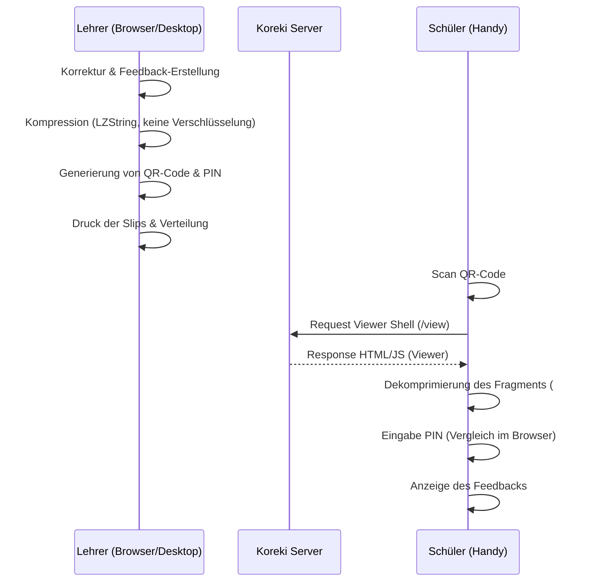

# Digital Feedback Slips

## 1. Executive Summary & Kontext
> [!NOTE]
> **Zusammenfassung:** Ermöglicht Lehrern die Verteilung von detailliertem Schülerfeedback über physische Rückgabe-Slips mit QR-Codes. Die Daten stecken komprimiert im QR-Code und werden nie auf Koreki-Servern gespeichert. Sie sind **nicht verschlüsselt**: Wer den QR-Code hat, kann den Inhalt lesen.
> **Zielgruppe:** Lehrer (Nutzer), Administratoren, Datenschutzbeauftragte.

In vielen Schulen ist die Verteilung von digitalem Feedback aufgrund strenger Datenschutzauflagen (keine Cloud-Speicherung von Schülerdaten) schwierig. Die Digital Feedback Slips lösen dieses Problem durch eine „Offline-First“ Distribution, bei der das Feedback direkt im URL-Anker des QR-Codes transportiert wird.

---

## 2. Architektur & Systemdesign
> [!TIP]
> Der Server liefert lediglich den statischen Viewer aus, sieht aber niemals den Inhalt des Feedbacks: Der steht im URL-Fragment (hinter `#`), das der Browser nicht mitsendet. Der Server sieht nur den Abruf selbst (IP-Adresse, Zeitpunkt).

---

## 3. Implementierung & Nutzung
Das Feature ist nahtlos in den **BatchProcessor** integriert.

### Nutzung für Lehrer:
1. Nach Abschluss der Korrekturen in der **ExportToolbar** auf „Digitale Slips“ klicken.
2. Im Export-System stehen zwei Optionen zur Verfügung:
   * **PDF Export (Empfohlen):** Generiert ein hochauflösendes PDF-Dokument mit optimiertem Layout und großen Namen für den Direktdruck.
   * **Direktdruck:** Browserbasierte Druckansicht der Slips.
3. Jeder Slip enthält:
   * **Name des Schülers** (Extra groß für die Zuordnung)
   * **Punkteübersicht** (Erreichte Punkte / Gesamtpunkte)
   * **QR-Code** (Optimierte Kapazität durch Level L)
   * **4-stelliger PIN** (aus dem Namen berechnet; Neugier-Bremse, kein Schutz)
4. Die Slips ausdrucken, an den gestrichelten Linien ausschneiden und verteilen.

### Nutzung für Schüler:
1. QR-Code scannen.
2. PIN vom Slip eingeben.
3. Detailliertes Feedback (Aufgaben-Punkte, Korrekturen, Folgefehler) einsehen.

---

## 4. Security & Compliance
> [!IMPORTANT]
> **Der Zettel ist so schutzbedürftig wie die korrigierte Arbeit.** Der QR-Code enthält Klarname, Punkte, das gesamte Feedback und den PIN — nur komprimiert, nicht verschlüsselt. Er gehört nur in die Hand der Person, der er gehört. So steht es auch im Handbuch (Kapitel „Exportieren“). Nirgends in App, Doku oder Marketing darf „verschlüsselt“ oder „sicher“ stehen.

* **Datenverarbeitung:** Es werden **keine personenbezogenen Daten** (PII) auf Koreki-Servern gespeichert. Das Feedback existiert auf dem Gerät des Lehrers, auf dem Zettel und temporär im Browser des Schülers. Der Abruf des Viewers (koreki.org/view, in allen drei Betriebsarten) hinterlässt beim Server IP-Adresse und Zeitpunkt, nicht den Inhalt.
* **PIN:** Rein clientseitige Abfrage, der PIN steht selbst im QR-Code. Er hält Neugierige vom schnellen Blick ab, ist aber kein Schutz: Wer den QR-Code hat, liest den Inhalt mit `LZString.decompressFromEncodedURIComponent` auch ohne PIN.
* **Bewusst nicht gebaut (12.11.2026):** Verschlüsselung mit einem aus dem PIN abgeleiteten Schlüssel. Ein vierstelliger PIN ist offline in Sekunden durchprobiert, und ein längerer Code stünde auf demselben Zettel wie der QR-Code — der Gewinn rechtfertigt den Aufwand nicht.
* **Transport:** Die Seite wird per TLS ausgeliefert; die Daten selbst stehen im URL-Fragment und werden nie an den Webserver gesendet.

---

## 5. Technische Kapazitäten & Limits
> [!CAUTION]
> Obwohl QR-Codes sehr effizient sind, gibt es physikalische Limits für die Datenmenge.

* **Kapazität:** Durch den Wechsel auf **Error Correction Level L** wurde die Kapazität auf ca. **2.900 komprimierte Zeichen** (~5.000-6.000 Zeichen Reintext) erhöht. Dies entspricht etwa 1.5 bis 2 vollen DIN-A4-Seiten Feedback.
* **Safety-Checks:** Das System prüft die Datenmenge vor der Generierung. Bei Überschreitung wird eine Warnung ausgegeben, um fehlerhafte QR-Codes oder Browser-Crashes zu verhindern.

---

## 6. Testing & Referenzen
* **Unit-Tests:** `tests/unit/distribution.test.ts` (Encoding/Decoding Logic)
* **Integration-Tests:** `tests/integration/DigitalSlipsModal.test.tsx`
* **Technologien:** LZ-String (Kompression), jsPDF (PDF-Generierung), qrcode.react (QR-Generierung).
