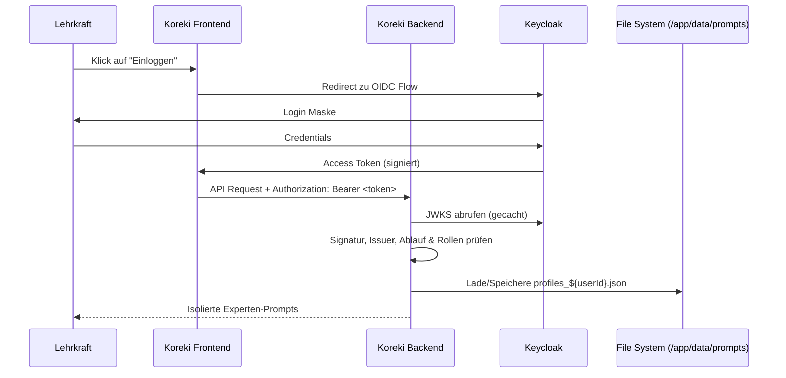

# Community Multi-User Setup (Keycloak & Docker)

## 1. Executive Summary & Kontext
> [!NOTE]
> **Zusammenfassung:** Technische Referenz für den Betrieb der Community Edition mit mehreren Lehrkräften. Keycloak verwaltet die Konten, ein Nginx-Gateway bündelt App und Anmeldung auf einem Port.
> **Zielgruppe:** Entwickler und Admins, die tiefer einsteigen als der Assistent.

> [!IMPORTANT]
> **Die Schritt-für-Schritt-Anleitung für die Schul-IT steht im Handbuch:** [Koreki für die ganze Schule](https://hilfe.koreki.org/schule/) — Varianten, Installation mit dem Assistenten, erste Anmeldung, Lehrkräfte anlegen, KI anbinden, Updates, häufige Fehler. Dieses Dokument wiederholt das nicht, sondern beschreibt, was darunter liegt.

---

## 2. Architektur & Systemdesign

```
                          ┌──────────────────────────────────────────────┐
Internet → HAProxy (:443) → Nginx Gateway (:80/PUBLIC_PORT) → Koreki (:3000)
           (SSL Term.)    │                                  → Keycloak (:8080)
                          └──────────────────────────────────────────────┘
```

- **Nginx Gateway** (`infra/community/nginx.conf`) bündelt alle Anfragen auf `PUBLIC_PORT`: `/` → Koreki, `/auth` → Keycloak.
- **PostgreSQL** dient Keycloak als Datenbank.
- Die Authentifizierung folgt OIDC. Koreki ist öffentlicher Client (SPA mit PKCE `S256`).



---

## 3. Implementierung & Nutzung

### Umgebungsvariablen

Der Assistent (`scripts/cli/index.mjs`, Option 2) schreibt sie in die `.env`. Bei manueller Einrichtung:

| Variable | Bedeutung |
| :--- | :--- |
| `APP_URL` | Die Adresse, unter der Nutzer Koreki aufrufen, mit Schema und Port. **Herzstück des Setups** — Redirect-URIs und Issuer hängen daran. |
| `APP_HOSTNAME` | Hostname aus `APP_URL`. |
| `PUBLIC_PORT` | Port, an den Docker das Gateway auf dem Host bindet (Vorgabe `8080`). |
| `KC_HOSTNAME_PORT` | Port in Keycloak-URLs; `-1` hinter einem Reverse Proxy auf 443/80, sonst wie `PUBLIC_PORT`. |
| `KC_ADMIN_PASSWORD`, `KC_DB_PASSWORD` | **Pflicht.** Fehlt eine, bricht `docker compose` bewusst ab, statt ein Standardpasswort zu nutzen. Erzeugen z. B. mit `openssl rand -hex 16`. |
| `NEXT_PUBLIC_KOREKI_MODE=community` | Community-Modus. |
| `NEXT_PUBLIC_AUTH_TYPE=KEYCLOAK` | OIDC-Pfad im Frontend. |
| `NEXT_PUBLIC_OIDC_ISSUER` | Realm-URL, z. B. `${APP_URL}/auth/realms/koreki`. Gegen diesen Wert wird der `iss`-Claim jedes Tokens geprüft. |
| `NEXT_PUBLIC_OIDC_CLIENT_ID` / `OIDC_CLIENT_ID` | Client in Keycloak, Standard `koreki-app`. |
| `OIDC_ISSUER_INTERNAL` | Optional: Pfad, über den der Server die JWKS abruft, wenn die öffentliche URL aus dem Container nicht auflösbar ist. Im mitgelieferten Stack `http://gateway/auth/realms/koreki`. |
| `MISTRAL_API_KEY`, `MITTWALD_API_KEY` | Optional: zentrale Schlüssel für alle Nutzer. |
| `NEXT_PUBLIC_HAS_GLOBAL_AI=true` | Globale Schlüssel vorhanden — unterdrückt das Setup-Modal für Endnutzer. |

Beispiele für `APP_URL`: lokal `http://localhost:8080` (dann `KC_HOSTNAME_PORT=8080`), hinter einem Reverse Proxy `https://koreki.deine-schule.de` (dann `KC_HOSTNAME_PORT=-1`).

> [!WARNING]
> Wer `APP_URL` oder andere `NEXT_PUBLIC_*`-Werte nachträglich ändert, muss mit `--build` neu bauen — sie werden beim Build ins Frontend geschrieben.

### Manuelle Installation

```bash
git clone https://github.com/koreki-org/koreki.git
cd koreki
# .env gemäß Tabelle anlegen
docker compose -f docker-compose.community-multi-full.yml up -d --build
```

Beim ersten Start importiert Keycloak den Realm aus `keycloak/koreki-realm.json` (eine Datei für alle Umgebungen, Redirect-URIs setzt der Assistent aus `APP_URL`). Das dauert 60–90 Sekunden.

### Externer Keycloak

1. **Realm:** `koreki`.
2. **Client:** OIDC-Client `koreki-app`, Access Type Public, PKCE `S256`, Valid Redirect URIs `APP_URL` + `/*`, Web Origins `APP_URL`.
3. **Rollen:** Realm-Rollen `koreki-user` (Standard) und `koreki-admin` (Zugriff auf die zentralen KI-Einstellungen).

> [!NOTE]
> Ein eigener Protocol-Mapper für Rollen ist **nicht** nötig. Der Server liest `realm_access.roles`, das Keycloak über den Standard-Client-Scope `roles` immer mitliefert.

Der Realm legt den Nutzer `koreki` mit Admin-Rolle **ohne Passwort** an, damit keine Installation mit bekanntem Standardzugang ans Netz geht. Das Freischalten beschreibt das [Handbuch](https://hilfe.koreki.org/schule/#anmeldung).

---

## 4. Security & Compliance (Industrial Grade)
> [!IMPORTANT]
> Die Identität stammt ausschließlich aus dem **signierten Access Token**. Der Server verifiziert bei jedem Request Signatur (via JWKS), Issuer, Client-Bindung und Ablauf, bevor `sub` und Rollen verwendet werden. Client-gelieferte Identitäts-Header sind keine Vertrauensquelle.

* **Datenverarbeitung:** Schülerdaten werden im RAM verarbeitet und nicht gespeichert. Profile liegen je Nutzer isoliert in `/app/data/prompts/profiles_${userId}.json`.
* **Authentifizierung:** über Keycloak. Passwörter liegen nie in Koreki.
* **Audit-Logs:** Kritische Aktionen (Logins, Profil-Änderungen) erfasst `audit-service.ts` im Backend.
* **Admin-Konsole:** `KC_ADMIN_PASSWORD` schützt `<APP_URL>/auth/admin` — die volle Kontrolle über alle Konten.

---

## 5. Diagnose

Die häufigen Fehler (502 beim Start, `redirect_uri`, fehlende Admin-Rechte, Seite ohne Styles) stehen im [Handbuch](https://hilfe.koreki.org/schule/#probleme). Hier nur, was tiefer geht:

### Login klappt, aber die App meldet durchgehend 401
Der Server verifiziert jedes Token gegen die JWKS von Keycloak. Schlägt der Abruf fehl, werden alle Anfragen abgelehnt.
- Logs: `docker compose logs koreki | grep JWKS`
- Erreichbarkeit aus dem App-Container (erwartet: `sig-Keys: [ 'RS256' ]`):
  ```bash
  docker compose -f docker-compose.community-multi-full.yml exec -T koreki node -e "fetch('http://gateway/auth/realms/koreki/protocol/openid-connect/certs').then(r=>r.json()).then(j=>console.log('sig-Keys:',j.keys.filter(k=>k.use==='sig').map(k=>k.alg)))"
  ```
- Issuer prüfen (muss exakt `NEXT_PUBLIC_OIDC_ISSUER` entsprechen):
  ```bash
  curl -s <APP_URL>/auth/realms/koreki/.well-known/openid-configuration | grep -o '"issuer":"[^"]*"'
  ```
- Liefert das nichts, `OIDC_ISSUER_INTERNAL` in der Compose-Datei auf einen aus dem Container erreichbaren Pfad setzen.

### `exec: ./start.sh: not found`
Gecachte Images mit Windows-Zeilenumbrüchen. Lösung:
```bash
docker compose -f docker-compose.community-multi-full.yml build --no-cache
```

---

## 6. Testing & Referenzen
* **Verwandte Dokumente:** [Community Persistence Doku](../technical/community-edition-persistence.md), [Datenschutz für Schulen](../user-guides/datenschutz-paket-schulen.md)
* **Test-Coverage:** Der Keycloak-Login-Flow ist derzeit NICHT durch E2E-Tests abgedeckt. Das frühere `tests/e2e/auth.setup.ts` meldete sich gegen die Produktion an und wurde am 19.08.2026 entfernt; die lokale Test-Kette läuft ohne Login (`NEXT_PUBLIC_AUTH_TYPE=NONE`).
